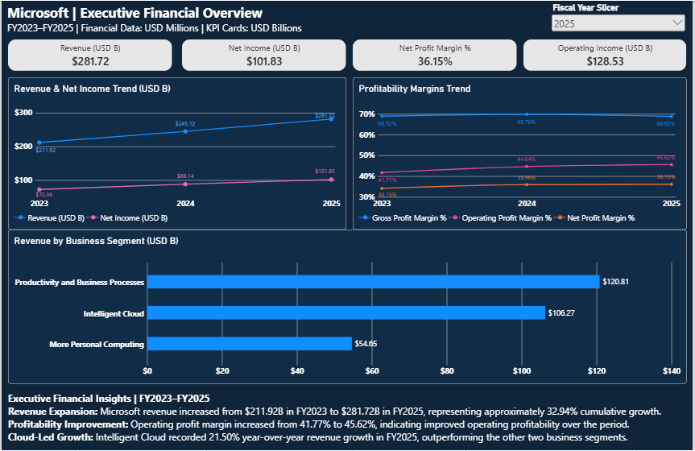
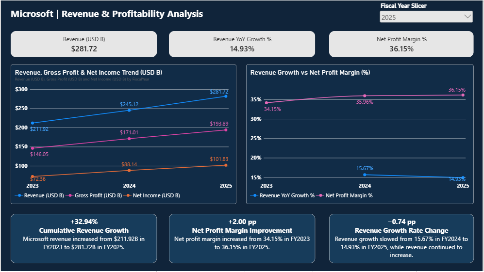
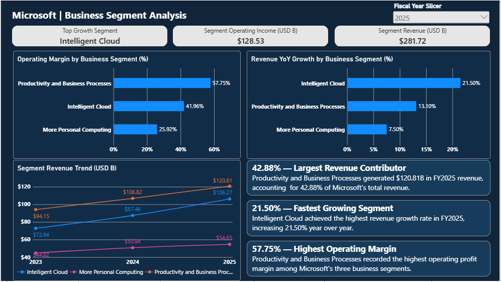
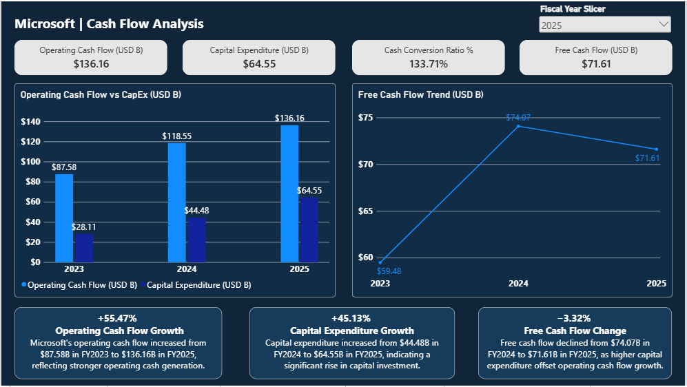
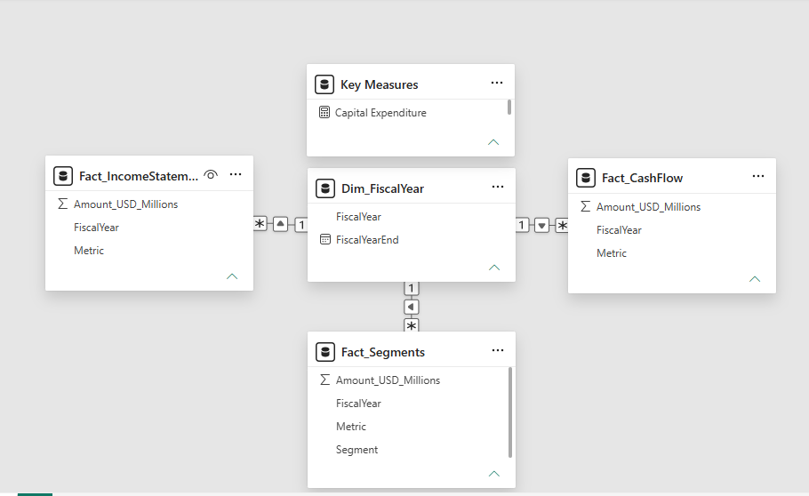

[README (1).md](https://github.com/user-attachments/files/34015304/README.1.md)
# Microsoft Financial Performance Analysis | Power BI

An interactive Power BI financial analytics portfolio project exploring Microsoft’s financial performance across fiscal years **FY2023–FY2025**. The report covers revenue growth, profitability, business segment performance, and cash flow trends.

> **Portfolio project disclaimer:** This is an independent educational analysis, not an official Microsoft dashboard. Financial figures should be reconciled against Microsoft’s published annual reports before being used for financial decisions.

## Project Overview

This dashboard turns financial statement and segment data into a concise, executive-focused view of business performance. It combines a fiscal-year dimension, three fact tables, DAX measures, and interactive reporting.

### Dashboard Pages

1. **Executive Overview** — headline financial KPIs, multi-year trends, and segment revenue contribution.
2. **Revenue & Profitability Analysis** — revenue growth, gross profit, net income, and profitability margins.
3. **Business Segment Analysis** — segment revenue, operating income, growth, and operating margins.
4. **Cash Flow Analysis** — operating cash flow, capital expenditure, free cash flow, and cash conversion.

## Key Financial Findings

- FY2025 revenue: **$281.72 billion**.
- FY2025 net income: **$101.83 billion**.
- FY2025 operating income: **$128.53 billion**.
- FY2025 net profit margin: **36.15%**.
- FY2025 Intelligent Cloud revenue year-over-year growth: **21.50%**.
- FY2025 operating cash flow: **$136.16 billion**.
- FY2025 capital expenditure: **$64.55 billion**.
- FY2025 free cash flow (operating cash flow minus capital expenditure): **$71.61 billion**.

**Units:** Source financial amounts are in USD millions; dashboard headline amounts are presented in USD billions.

## Dashboard Screenshots

### 1. Executive Overview


### 2. Revenue & Profitability Analysis


### 3. Business Segment Analysis


### 4. Cash Flow Analysis


### 5. Data Model


## Data Model

A fiscal-year dimension (`Dim_FiscalYear`) connects to three fact tables using one-to-many relationships:

- `Fact_IncomeStatement`
- `Fact_Segments`
- `Fact_CashFlow`

DAX measures calculate financial totals, margins, year-over-year changes, and cash flow indicators. Fiscal-year filters drive relevant KPI cards and segment comparisons while multi-year trend charts retain historical context.

## Technologies & Skills

- Microsoft Power BI Desktop
- Power Query and data modeling
- DAX measures and time-based comparisons
- Financial statement analysis and KPI design
- Data visualization and dashboard storytelling

## Repository Contents

```text
Microsoft-Financial-Performance-Analysis-PowerBI/
├── README.md
├── Microsoft_Financial_Performance_Analysis.pbix
├── Data/
│   ├── README.md
│   ├── cash_flow.csv
│   ├── fiscal_years.csv
│   ├── income_statement.csv
│   └── segments.csv
└── Screenshots/
    ├── README.md
    ├── Executive_Overview.PNG
    ├── Revenue_Profitability.PNG
    ├── Business_Segments.PNG
    ├── Cash_Flow.PNG
    └── Data_Model.PNG
```

## How to Explore

1. Download [`Microsoft_Financial_Performance_Analysis.pbix`](Microsoft_Financial_Performance_Analysis.pbix).
2. Open it with Microsoft Power BI Desktop.
3. Explore the four dashboard pages and change the fiscal-year slicer to compare annual KPIs.
4. If Power BI prompts for data source paths, point the queries to the files in [`Data/`](Data/).

## Data Sources & References

The dataset is based on Microsoft’s publicly reported financial results for fiscal years 2023–2025. For independent verification, refer to Microsoft’s official annual reporting resources:

- [Microsoft Investor Relations — Annual Reports](https://www.microsoft.com/en-us/Investor/annual-reports.aspx)
- [Microsoft Investor Relations](https://www.microsoft.com/en-us/Investor/)

## Author

[Mohhim](https://github.com/Mohhim) — Power BI / Data Analytics Portfolio
